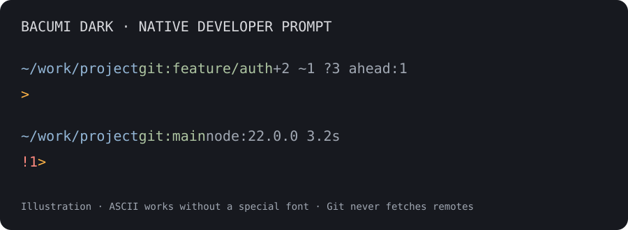
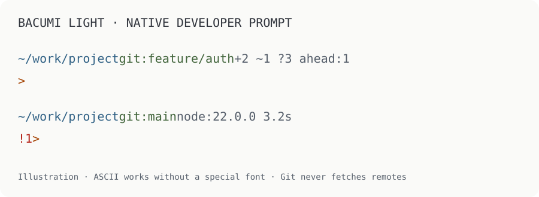
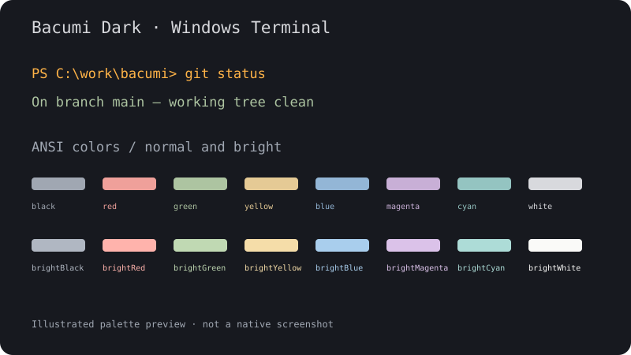
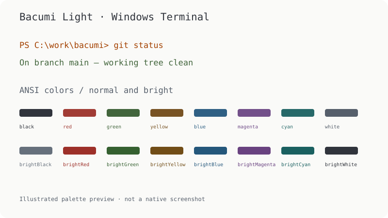

<div align="center">
  <picture>
    <source media="(prefers-color-scheme: dark)" srcset="assets/icons/icon-dark-128.png">
    
  </picture>
  <h1>Bacumi for Windows Terminal</h1>
  <p>Bacumi colors and a native developer prompt, in Dark and Light.</p>
  <p>
    <a href="https://github.com/bacumi-tech/bacumi-windows-terminal-theme/releases/tag/v0.2.0">Download 0.2.0 preview</a> ·
    <a href="#installation">Installation</a> ·
    <a href="BRAND.md">Brand and icons</a> ·
    <a href="LICENSE">MIT license</a>
  </p>
</div>

Bacumi Dark pairs a Graphite background with warm accents. Bacumi Light brings
the same color roles to an Off-White workspace. Both include a complete ANSI
palette for command output, with sage greens, quiet blues and Amber focus.
The optional native PowerShell prompt adds detailed Git state, project runtimes,
command results and session context without another prompt engine.

**Preview release.** Automated scheme and installer checks run on GitHub Actions.
Native Windows Terminal visual review is still pending; see [validation](VALIDATION.md).

## Developer prompt preview

<table>
  <tr><th>Dark</th><th>Light</th></tr>
  <tr>
    <td width="50%"></td>
    <td width="50%"></td>
  </tr>
</table>

Illustrations of the native developer layout, not terminal screenshots.

## Palette and lightweight preview

<table>
  <tr><th>Bacumi Dark</th><th>Bacumi Light</th></tr>
  <tr>
    <td width="50%"></td>
    <td width="50%"></td>
  </tr>
</table>

Illustrated palette previews, not native Terminal screenshots. Select either
scheme for your PowerShell, Command Prompt or WSL profile; the profile's shell,
font and keybindings stay as configured.

## Installation

### Requirements

- Windows with Windows Terminal supporting JSON fragment extensions.
- Windows PowerShell 5.1 or PowerShell 7 to run the installer.

Installation is per user and requires no administrator access, Git or package manager.

### 1. Download and extract

Download [bacumi-windows-terminal-theme-0.2.0.zip](https://github.com/bacumi-tech/bacumi-windows-terminal-theme/releases/download/v0.2.0/bacumi-windows-terminal-theme-0.2.0.zip)
from the [GitHub release](https://github.com/bacumi-tech/bacumi-windows-terminal-theme/releases/tag/v0.2.0).
The release also includes `SHA256SUMS`. From your download folder, calculate
the ZIP's SHA-256 and compare it with the entry in that checksum file:

```powershell
Get-FileHash .\bacumi-windows-terminal-theme-0.2.0.zip -Algorithm SHA256
```

Extract the ZIP and open PowerShell in the extracted folder containing `Install.ps1`.

### 2. Install both appearances

```powershell
powershell.exe -NoProfile -ExecutionPolicy Bypass -File .\Install.ps1
```

The execution-policy option applies only to this installer process. Both schemes
are added through a native fragment at:

```text
%LOCALAPPDATA%\Microsoft\Windows Terminal\Fragments\Bacumi\bacumi.json
```

The installer preserves `settings.json` and your existing profile selections.
Use `-WhatIf` to preview its actions or `-FragmentRoot 'C:\path\to\Fragments'`
for a custom fragment directory.

### 3. Select your scheme

Reopen Windows Terminal. Go to **Settings → your profile → Appearance → Color
scheme**, choose **Bacumi Dark** or **Bacumi Light**, and save.

To follow the application's Dark/Light appearance on compatible Terminal
versions, add this property to your existing profile in `settings.json`:

```json
"colorScheme": {
  "dark": "Bacumi Dark",
  "light": "Bacumi Light"
}
```

### Manual installation

Copy [fragments/bacumi.json](fragments/bacumi.json) into a `Bacumi` folder under
the fragment directory above. Alternatively, merge the individual
[Dark](schemes/bacumi-dark.json) and [Light](schemes/bacumi-light.json) objects into
your settings' `schemes` array. Select the scheme in your profile afterward.

Manage manual copies manually. The installer protects folders it does not own.

## Native PowerShell developer prompt

From the same extracted release folder, install the module independently of the
color schemes:

```powershell
powershell.exe -NoProfile -ExecutionPolicy Bypass -File .\Install-Prompt.ps1
```

Then in the PowerShell session you use every day:

```powershell
Import-Module BacumiPrompt
Enable-BacumiPrompt -Appearance Dark
# Or: Enable-BacumiPrompt -Appearance Light -Layout Compact
```

The installer prints the module location and activation lines. It leaves
`$PROFILE` unchanged; add those two lines to your profile yourself for future
sessions. Use `-ModuleRoot PATH` for an explicit module root, including when your
installation and interactive PowerShell editions use different module paths.
Use an absolute `Import-Module` path if the printed destination is outside the
current session's module search path. Disable any existing prompt-engine
initialization while trying Bacumi.

| Indicator | Meaning |
| --- | --- |
| Directory | Current path, shortened to fit |
| `git:main` | Current branch, including an unborn branch |
| `+2 ~1 ?3` | 2 staged, 1 unstaged and 3 untracked files |
| `conflict:1` | 1 conflicted file |
| `ahead:2 behind:1` | Commits against the locally known upstream |
| `merge` / `rebase` | Operation in progress |
| `node:22…` | Active runtime version in a relevant project |
| `!1` | Previous command failed with status 1 |
| `3.2s` | Previous command took at least two seconds |

Git counts describe file records, not changed lines. The prompt never fetches
remotes. Runtime versions appear only for relevant projects or environments.
Narrow windows prioritize directory, branch, conflicts and failure state.

```powershell
Enable-BacumiPrompt -Appearance Dark -Layout Developer -ColorMode Auto
# -ColorMode TrueColor, Ansi or Plain
# -GitMode Fast  # omit detailed file counts for large repositories
# -GitMode Off   # disable Git queries
Disable-BacumiPrompt  # restore the previous prompt in this session
```

Command Prompt uses only the color scheme. For Zsh in WSL, install the
[companion native Zsh prompt](https://github.com/bacumi-tech/bacumi-oh-my-zsh-theme).
PowerShell and Zsh share indicator meanings and the approved palette.

To update, run `Install-Prompt.ps1` from the newer release and restart the shell
or reimport the module with `-Force`. To uninstall, remove the import/activation
lines from your profile, disable the prompt, then run:

```powershell
.\Install-Prompt.ps1 -Uninstall
```

Pass the same `-ModuleRoot` used during installation. Owned local edits and
unrelated modules are protected. `-WhatIf` previews changes.

## Optional step: install the font

Plain text is the default and needs no special font. For optional icons, run:

```powershell
powershell.exe -NoProfile -ExecutionPolicy Bypass -File .\Install-Font.ps1
```

This downloads four pinned **MesloLGS NF** faces over HTTPS and verifies all
SHA-256 hashes before installation. Fonts are installed and registered per user;
no administrator rights or package manager are needed. Sign out of Windows and
sign back in to make the per-user registration available to all apps. Then select **MesloLGS NF** in
**Windows Terminal → Settings → your profile → Appearance → Font face**, then:

```powershell
Enable-BacumiPrompt -Appearance Dark -Icons
```

Font selection stays manual. Install on the Windows host even if your shell is
in WSL. The font retains its [upstream notice](fonts/LICENSE-MesloLGS-NF.txt),
[Apache 2.0 license](fonts/Apache-2.0.txt) and [copyright notices](fonts/NOTICE.txt).
Font binaries are not bundled with the theme. Failed downloads/hash checks
leave installed fonts untouched. Existing matching fonts remain unowned.

```powershell
.\Install-Font.ps1 -Uninstall
```

After removal, sign out and sign back in to refresh fonts in all apps.
Removal touches only verified installer-owned files and registration entries;
local edits and third-party installations are protected. Use the same custom
`-FontDirectory` / `-RegistrationPath` if you supplied them. `-SourceDirectory`
and `-ManifestPath` support offline verification and controlled contributor
tests; only use trusted manifests. `-WhatIf` previews changes.

## Update and uninstall

**Update:** download and extract a newer release, then run its installer again.
If an installed Bacumi file has local edits, installation stops so you can back
up or move your custom copy first. Keep personal schemes under separate names.

**Uninstall:** from the extracted release folder, run:

```powershell
powershell.exe -NoProfile -ExecutionPolicy Bypass -File .\Install.ps1 -Uninstall
```

Pass the same `-FragmentRoot` if you used a custom location. Select another scheme
if a profile still refers to Bacumi. Removal preserves unrelated files. For a
manual installation, delete the fragment you copied or remove the scheme objects
you added to your settings.

## Brand and artwork

The themes follow Bacumi Brand v1.0's approved editor palette. The companion
[Oh My Zsh theme](https://github.com/bacumi-tech/bacumi-oh-my-zsh-theme) uses the
same palette revision for coordinated shell prompts under WSL.

[Product artwork](assets/icons/) includes Dark/Light SVG masters and transparent
PNGs from 16 to 1024 px, with [provenance](assets/icons/provenance.json). The icons
are available for documentation, listings and shortcuts. Installing a color
scheme does not replace the Windows Terminal application icon.

Read [BRAND.md](BRAND.md) for color roles, icon rationale and reproduction details.

## Development

<details>
<summary>Build, verify and contribute</summary>

Use a source checkout with Python 3.10+. Build and validation use the standard
library and do not require a private Bacumi repository.

```sh
python3 scripts/build.py --check
python3 scripts/build-developer-preview.py --check
python3 scripts/build-icons.py --check
python3 scripts/check-brand.py
python3 -m unittest discover -s tests -v
python3 scripts/package.py
python3 scripts/check-package.py
```

On Windows, verify installation and removal in temporary directories:

```powershell
powershell.exe -NoProfile -ExecutionPolicy Bypass -File .\tests\install.Tests.ps1
```

Edit `palette.json`, then run `python3 scripts/build.py` to regenerate the schemes
and illustrated previews. Brand changes require review of both appearances.
Regenerate icon SVGs with `python3 scripts/build-icons.py`; optional PNG export
uses `python3 scripts/export-icons.py` with PyMuPDF in the contributor environment.
Committed PNGs require no renderer to use or verify.

CI checks source consistency, brand colors, icon hashes and native installation
under Windows PowerShell 5.1 and PowerShell 7. See the [validation record](VALIDATION.md),
[changelog](CHANGELOG.md) and [contribution guide](CONTRIBUTING.md).

</details>

## Support and license

[Open an issue](https://github.com/bacumi-tech/bacumi-windows-terminal-theme/issues)
with your Terminal version, selected appearance and a non-sensitive example.

Theme definitions, palette, code, documentation and original product icons are
covered by the [MIT License](LICENSE). Bacumi names identify this project;
trademark rights and endorsement of forks are not granted. The themes make no
runtime network requests and collect no telemetry. The optional font installer downloads only
the manifest URLs; fonts retain their upstream license.

Built using Microsoft's [color scheme](https://learn.microsoft.com/en-us/windows/terminal/customize-settings/color-schemes)
and [JSON fragment](https://learn.microsoft.com/en-us/windows/terminal/json-fragment-extensions)
interfaces.
